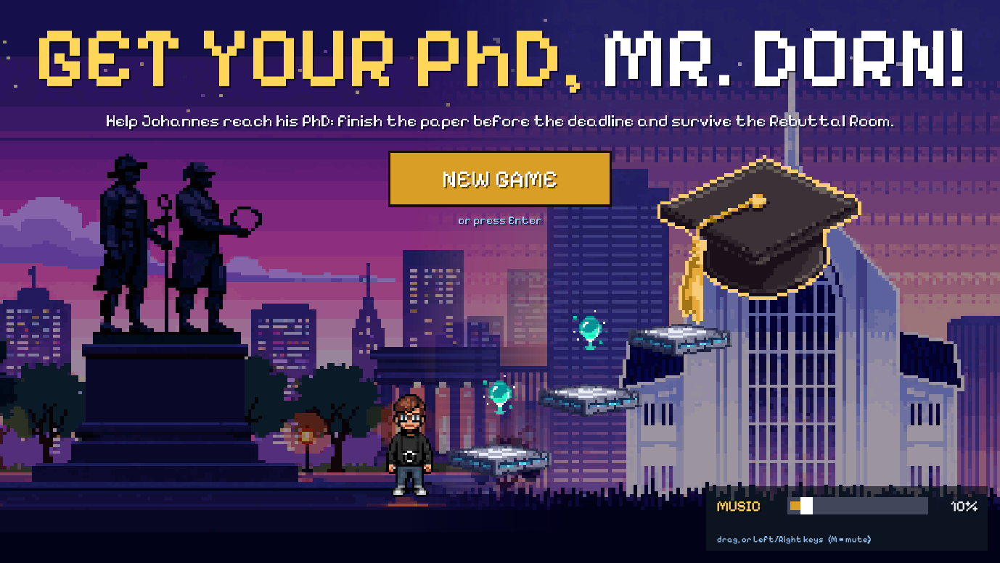
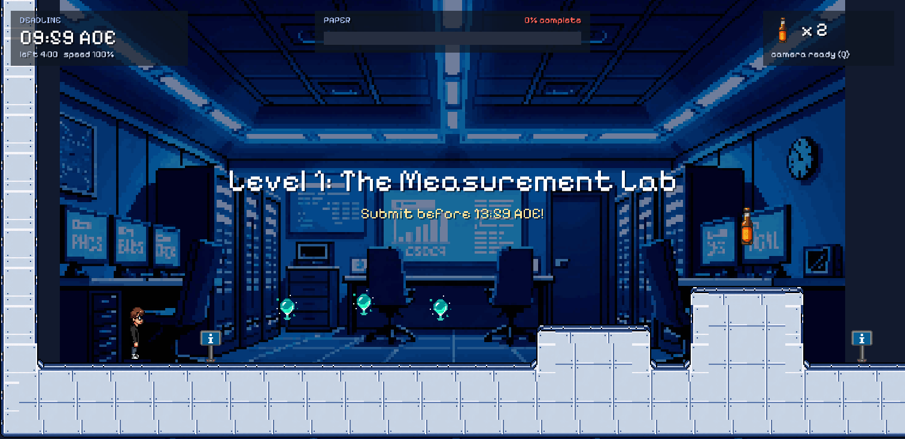
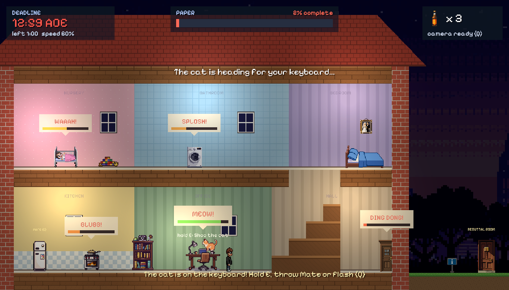
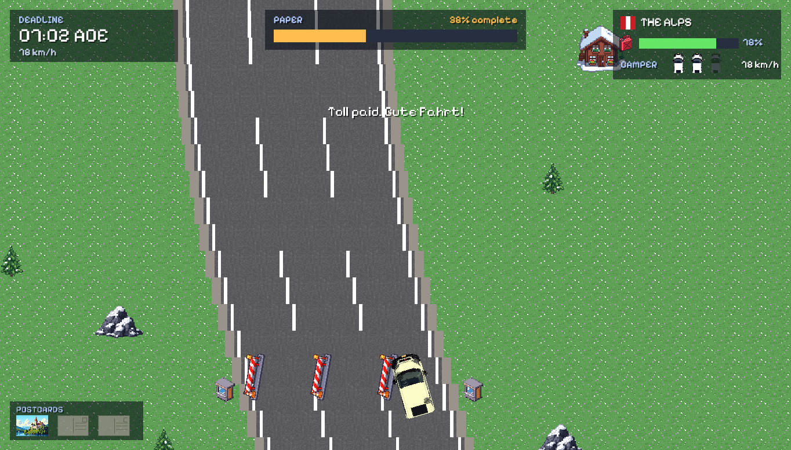
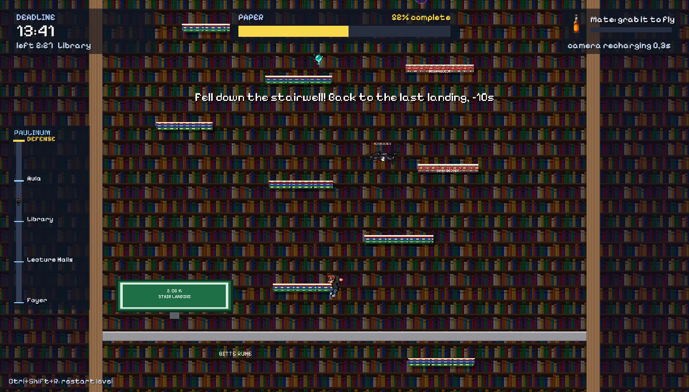
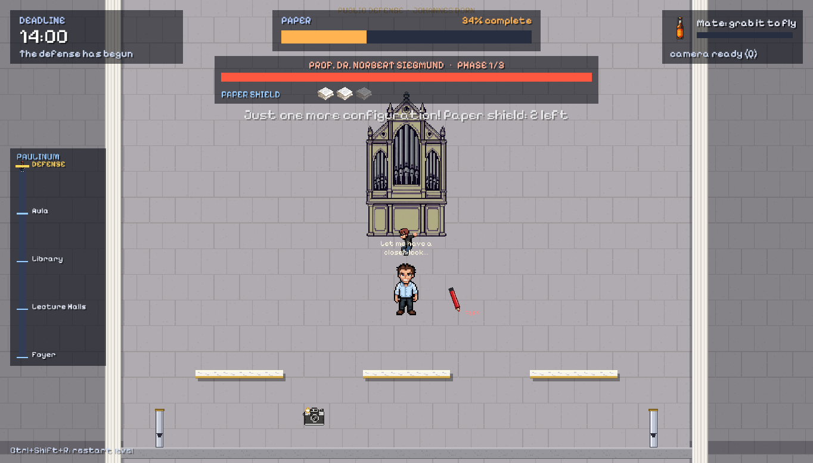

# Get Your PhD, Mr. Dorn!

A pixel-art 2D game made in Unity 6 as a gift for Johannes Dorn's PhD defense.
Help Johannes finish his paper before the deadline, survive Reviewer 2, make it to the
Paulinum in Leipzig and defend his thesis.

## The levels

### Level 1: The Measurement Lab
A platformer level in the lab. Run and jump through the lab, collect data points, feedback,
experiment results and paper drafts to fill the paper meter, beat the Benchmark Cluster and
hit the Submit button before the deadline. Then win the Rebuttal Room.

### Level 2: Home Sweet Home Office
Try to write your paper at home while the baby cries, the washing machine floods,
the cat sits on the keyboard and the doorbell rings. Fix the problems around the flat
and keep the paper moving.

### Level 3: The Camper Road Trip
Drive the camper from Italy through Austria and Germany to Leipzig. Dodge Vespas, cows,
falling rocks and Reviewer 2, refuel at gas stations, pay the toll and collect postcards
along the way.

### Level 4: Climb the Paulinum
The defense starts at 14:00 on the top floor and the lift is out of order. Bounce up through
the foyer, lecture halls and library, and finally face Prof. Siegmund in the defense,
with all the papers from earlier levels as your shield.

| The climb | The defense |
|---|---|
|  |  |

## Controls

| Action | Keyboard / Mouse | Gamepad |
|---|---|---|
| Move | A / D or ← / → | Left stick |
| Jump (again in the air for a double jump) | Space / W / ↑ | A |
| Drink Mate (speed boost) | Left click | Y |
| Throw Mate | Right click | X |
| Camera flash (stun, reveal, take photos) | Q | B |
| Interact | E / S / ↓ | RB |
| Pause | Esc | Start |
| Restart level | Ctrl + Shift + R | |

Each level has its own "How to play" screen with the details.

## Running the project

1. Install **Unity 6000.2.7f2** (Unity 6) via Unity Hub.
2. Clone this repository and open the folder in Unity Hub with "Add project from disk".
3. Open `Assets/Scenes/StartScreen.unity` and press Play.

The game uses the Universal Render Pipeline (2D) and the new Input System.

## Project structure

| Folder | Content |
|---|---|
| `Assets/Scenes` | Start screen and the four levels |
| `Assets/Scripts` | Game code (Core, Player, Gameplay, UI, Home, Road, Climb) |
| `Assets/Levels` | Text-based level layouts |
| `Assets/Art`, `Assets/Resources` | Sprites, audio and other assets |
| `LevelTools` | Python helper scripts for level generation and asset preparation |
| `PixelLabRaw` | Raw pixel-art source files |

## Credits

Pixel art was created with [PixelLab](https://www.pixellab.ai/).
All music and sound effects are CC0 or public domain. See
[`Assets/Resources/Audio/CREDITS.md`](Assets/Resources/Audio/CREDITS.md) for the full list of
authors and sources. The font is licensed under the SIL Open Font License
(see `Assets/Fonts/OFL.txt`).
